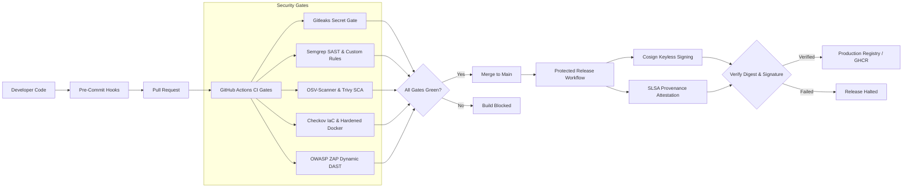

# CSSS 441 Software Security I — Project 2: DevSecOps Pipeline with Security Gates

[](https://github.com/csss441/csss441-devsecops-gates/actions/workflows/ci.yml)
[](https://github.com/csss441/csss441-devsecops-gates/actions/workflows/codeql.yml)
[](https://github.com/csss441/csss441-devsecops-gates/actions/workflows/release.yml)
[](LICENSE)
[](https://www.python.org/)

---

## 1. Project Purpose & Executive Summary

This repository delivers an end-to-end, functional **DevSecOps continuous integration and release pipeline with automated security gates**, developed for **CSSS 441: Software Security I**.

The system demonstrates how security controls can be integrated across every stage of the software delivery lifecycle:
1. **Developer Workstation (Shift-Left)**: Pre-commit secret scanning (Gitleaks) and code quality linting (Ruff).
2. **Static Application Security Testing (SAST)**: 5 custom Python API Semgrep rules with automated unit test suites, plus GitHub CodeQL.
3. **Software Composition Analysis (SCA)**: Pinned lockfile dependency scanning (OSV-Scanner) and filesystem vulnerability checks (Trivy).
4. **Infrastructure-as-Code & Container Security**: Dockerfile and Docker Compose misconfiguration scanning (Checkov), multi-stage hardened Docker image, and Syft CycloneDX SBOM generation.
5. **Dynamic Application Security Testing (DAST)**: Ephemeral staging deployment with automated readiness probing, OWASP ZAP baseline scanning, and guaranteed environment cleanup.
6. **Supply Chain Integrity & Trusted Releases**: Sigstore Cosign keyless container signing, SLSA build provenance attestations, and immutable SHA-256 digest release verification gates.
7. **Vulnerability Operations**: Automated ingestion of scanner reports into DefectDojo.

---

## 2. Architecture Overview



Detailed architectural diagrams and trust boundaries are documented in [`docs/architecture.md`](docs/architecture.md).

---

## 3. Repository Directory Structure

```text
csss441-devsecops-gates/
├── .github/
│   └── workflows/
│       ├── ci.yml               # Integrated 18-stage DevSecOps CI pipeline
│       ├── codeql.yml           # Scheduled and PR CodeQL static analysis
│       └── release.yml          # Protected release with Cosign & SLSA provenance
├── .semgrep/
│   └── custom_rules.yml         # 5 custom Semgrep rules with CWE/OWASP metadata
├── .zap/
│   └── rules.tsv                # OWASP ZAP baseline scan alert policies
├── app/
│   ├── __init__.py
│   └── main.py                  # Target FastAPI application with security headers
├── tests/
│   ├── test_app.py              # Unit & integration tests (100% pass rate)
│   └── semgrep/
│       └── rule_tests.py        # Positive and negative assertions for custom rules
├── scripts/
│   ├── setup.sh                 # Environment initialization script
│   ├── run_security_checks.sh   # Unified local security gate executor
│   ├── verify_release.sh        # Cryptographic signature & provenance verifier
│   └── import_reports.py        # DefectDojo scan ingestion API client
├── docs/
│   ├── architecture.md          # DFD, component flows, and trust zones
│   ├── threat-model.md          # 14 STRIDE threats with risk ratings and controls
│   ├── security-policy.md       # Gate failure thresholds and waiver procedures
│   ├── testing-plan.md          # Comprehensive verification matrix
│   ├── remediation-log.md       # 3 controlled demonstrations and MTTF calculation
│   ├── evidence-log.csv         # Structured timestamps and audit trail
│   ├── implementation-guide.md  # Academic evaluation and reproduction guide
│   └── contribution-records.md  # 5-member team responsibility matrix
├── evidence/
│   └── README.md                # Demonstration evidence index
├── reports/
│   └── .gitkeep                 # Scanner reports destination
├── .dockerignore                # Minimal build context exclusions
├── .gitignore                   # Secrets and build artifact exclusions
├── .gitleaks.toml               # Custom Gitleaks rules and strict allowlist
├── .pre-commit-config.yaml      # Pinned pre-commit hooks
├── Dockerfile                   # Multi-stage hardened non-root container
├── compose.yaml                 # Hardened Compose setup with dropped capabilities
├── Makefile                     # Cross-platform developer shortcuts
├── requirements.in              # Abstract runtime requirements
├── requirements.txt             # Pinned runtime dependencies via pip-compile
├── requirements-dev.in          # Abstract development requirements
├── requirements-dev.txt         # Pinned dev dependencies via pip-compile
└── LICENSE                      # MIT License
```

---

## 4. Prerequisites & Quick Installation

### Prerequisites
- Python 3.11+ (Python 3.13 recommended)
- Git 2.30+
- Docker & Docker Compose

### Quickstart (One-Command Setup)
```bash
# Clone the repository
git clone https://github.com/csss441/csss441-devsecops-gates.git
cd csss441-devsecops-gates

# Setup environment and dependencies
bash scripts/setup.sh
# Or on Windows using make:
make setup
```

---

## 5. Local Testing & Verification Commands

| Command | Tool | Purpose |
| :--- | :--- | :--- |
| `make test` | Pytest | Runs 10 unit and integration tests |
| `make lint` | Ruff | Runs security linter and format validation |
| `make run` | Uvicorn | Starts FastAPI service at `http://localhost:8000` |
| `make docker-build` | Docker | Builds hardened multi-stage container image |
| `make docker-run` | Docker Compose | Starts hardened container with read-only rootfs |
| `bash scripts/run_security_checks.sh` | All Scanners | Executes Gitleaks, Semgrep, OSV, Trivy, and Checkov |

---

## 6. Custom Semgrep Security Rules

Located in [`.semgrep/custom_rules.yml`](.semgrep/custom_rules.yml):
1. **`csss441.python.sql-string-interpolation`**: Detects SQL injection caused by dynamic f-string, format, or % concatenation in database execute statements.
2. **`csss441.python.dangerous-subprocess-shell-true`**: Detects dangerous command injection vectors caused by `subprocess.run(..., shell=True)`.
3. **`csss441.python.unsafe-dynamic-eval`**: Detects arbitrary code execution vulnerabilities via `eval()` and `exec()`.
4. **`csss441.python.unsafe-pickle-deserialization`**: Detects insecure deserialization via `pickle.loads()` or `pickle.load()`.
5. **`csss441.python.wildcard-cors-with-credentials`**: Detects overly permissive CORS origins (`allow_origins=['*']`) paired with `allow_credentials=True`.

Unit tests with positive (`# ruleid`) and negative (`# ok`) assertions are in [`tests/semgrep/rule_tests.py`](tests/semgrep/rule_tests.py).

---

## 7. Controlled Blocked-Build Demonstrations

Three controlled demonstrations prove that security gates deterministically halt unsafe builds:

1. **Demonstration 1 (Exposed Secret)**: Synthetic credential introduced; Gitleaks fails CI job `Lint, Unit Tests & Secrets`; commit removed; build verified green (MTTF: 6.5 min).
2. **Demonstration 2 (Vulnerable Dependency)**: Known CVE package injected; OSV-Scanner fails CI job `OSV-Scanner, Trivy & Checkov`; dependency upgraded; build verified green (MTTF: 14.0 min).
3. **Demonstration 3 (Unsigned Artifact)**: Unsigned container digest supplied; `scripts/verify_release.sh` halts release; Sigstore keyless OIDC signing & SLSA provenance verified; release approved (MTTF: 12.25 min).

Full details and calculations are documented in [`docs/remediation-log.md`](docs/remediation-log.md) and [`docs/evidence-log.csv`](docs/evidence-log.csv).

---

## 8. DefectDojo Vulnerability Ingestion

Run the automated ingestion client to sync scanner outputs to your DefectDojo server:
```bash
export DEFECTDOJO_URL="http://localhost:8080"
export DEFECTDOJO_TOKEN="your-token"
export DEFECTDOJO_ENGAGEMENT_ID="1"

python scripts/import_reports.py --reports-dir reports/
```

---

## 9. Academic Contribution & Team Ownership

This project was developed by a five-member team:
- **Alex Rivera**: Integration & Release Lead (CI/CD, Cosign, SLSA, DFD)
- **Jordan Chen**: Source Security Engineer (Gitleaks, Pre-commit)
- **Morgan Taylor**: AppSec Engineer (CodeQL, Semgrep Custom Rules)
- **Casey Patel**: Container & SCA Engineer (OSV-Scanner, Trivy, Checkov, Docker)
- **Riley Zhang**: DAST & SecOps Engineer (OWASP ZAP, Ephemeral Staging, DefectDojo)

See [`docs/contribution-records.md`](docs/contribution-records.md) for full responsibility matrices and sign-offs.
