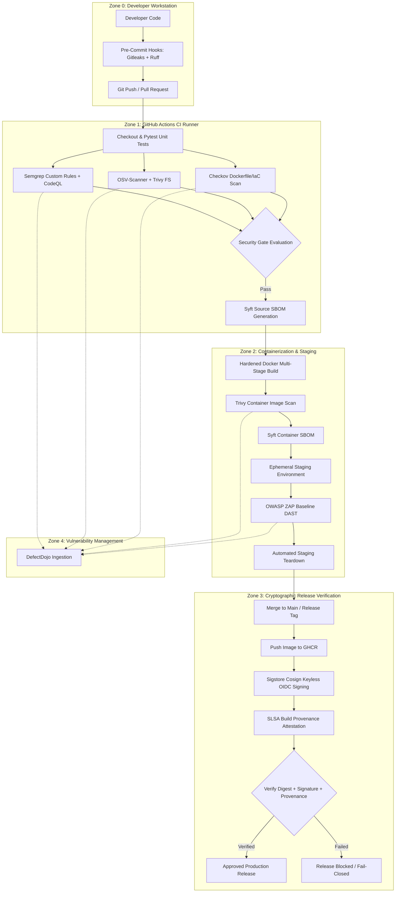

# System Architecture & DevSecOps Pipeline Design

## 1. System Overview

The **CSSS 441 Secure Book Catalogue** DevSecOps pipeline implements automated security controls across the entire Software Development Life Cycle (SDLC). The architecture follows a **Defense-in-Depth** and **Shift-Left** security paradigm: security issues are detected and remediated at the earliest possible stage (local pre-commit and pull request) before artifacts reach containerization, signing, or production deployment.

---

## 2. Security Boundaries & Trust Zones

| Trust Zone | Environment | Components | Trust Level | Security Controls Enforced |
| :--- | :--- | :--- | :--- | :--- |
| **Zone 0** | Developer Machine | Local Git clone, virtualenv, editor | Untrusted / Low | Pre-commit hooks (`gitleaks`, `ruff`), branch protection rules |
| **Zone 1** | GitHub Actions Runner | Ephemeral Ubuntu VM runner | Semi-Trusted | Minimum token permissions, secret scanning, custom SAST, SCA, IaC linting |
| **Zone 2** | Ephemeral Staging | Containerized API in test sandbox | Controlled Sandbox | Non-root user (`appuser:10001`), read-only rootfs, dropped capabilities, ZAP DAST |
| **Zone 3** | Artifact Registry & Release | GHCR, Sigstore, SLSA attestations | High Trust | Keyless cryptographic signing, immutable SHA-256 digest pinning, provenance verification |
| **Zone 4** | Vulnerability Management | DefectDojo Server | Protected Internal | Role-based access control (RBAC), scoped API tokens, findings deduplication |

---

## 3. Data Flow Diagram (DFD) Details

### Entities and Assets
1. **Source Code & Git History**: Target application (`app/main.py`), test suite, configuration manifests.
2. **Developer Credentials & Secrets**: API tokens, private keys, environment secrets.
3. **Container Image Artifacts**: Application binaries, wheels, base OS packages (`python:3.13-slim-bookworm`).
4. **Security Telemetry**: Machine-readable scan reports (JSON, SARIF, CycloneDX SBOMs).
5. **Cryptographic Attestations**: Sigstore OIDC certificates, transparency log entries (Rekor), SLSA build provenance attestations.

### Inter-Component Flows
1. **Developer to GitHub**: Code commits pushed over TLS via SSH/HTTPS. Gitleaks verifies no secret tokens are committed.
2. **CI Runner to GHCR**: Hardened container image pushed with short-lived GITHUB_TOKEN over TLS.
3. **Cosign to Fulcio & Rekor**: Keyless signing exchanges GitHub Actions OIDC identity token for short-lived certificate and registers signature in Rekor transparency log.
4. **Attestation Action to GitHub Registry**: SLSA provenance predicate cryptographically signed and stored in the registry alongside the image manifest.
5. **Release Gate Verification**: `scripts/verify_release.sh` downloads the signature and attestation, verifies OIDC issuer and repository subject, and halts if verification is incomplete.
